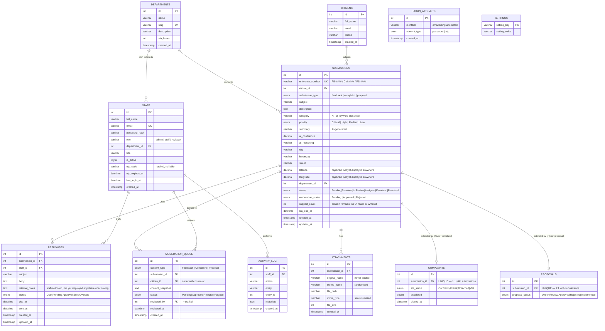

# CEPFMS — Entity Relationship Diagram

This reflects the actual schema in `database/migrations/` as of this writing — every
table, column, type, and foreign key below was pulled directly from that file, not written
from memory. If the schema changes, this document will drift out of date until it's
re-generated the same way.

## Diagram

## Notes on relationships not shown above

- **`ACTIVITY_LOG`** and **`SETTINGS`** aren't drawn with relationship lines to keep the
  diagram readable: `activity_log.entity` / `entity_id` is a polymorphic reference (can point
  at a submission, a moderation item, etc. depending on `entity`'s value) rather than a real
  foreign key, and `settings` is a standalone key-value store with no relationships at all.
- **`moderation_queue.citizen_id`** has no `FOREIGN KEY` constraint in the schema even though
  it conceptually points to `citizens.id` — worth adding if this schema is revised.

## Columns that hold real data but aren't surfaced in any UI yet

Different category from "dead" — these are actively written with genuine data, just never
read back or displayed anywhere afterward. Worth wiring up a display for these rather than
removing them:

- **`submissions.latitude` / `longitude`** — captured from the citizen's browser geolocation
  on every submission that uses "Use My Location," but no admin view ever reads them back
  (e.g. no map view exists).
- **`responses.internal_notes`** — staff actively type into this field when drafting a
  response (see `frontend/js/responses.js`), but nothing displays it again after saving —
  once written, it's effectively invisible even to the staff who wrote it.
- **`departments.description`** — every seeded department has a real, human-written
  description (e.g. "Roads, drainage, and infrastructure maintenance"), but no view — citizen
  or admin — ever displays it.

## What was removed and why

As of this revision, three tables and a few columns were removed after confirming via
project-wide search that they had **zero references anywhere in the application code** —
not written to, not read from, not displayed:

- **`consultations`** and **`consultation_comments`** — a public-consultation feature that
  was fully scaffolded at the database level (tables, foreign keys, even a moderation
  pathway) but never built out on the application side. No controller, API, or view ever
  touched them.
- **`assignments`** — logged every department assignment, but nothing ever read it back; the
  same event was already visibly logged via `activity_log`, which the UI actually displays.
  Kept the visible one, dropped the redundant invisible one.
- **`moderation_queue.comment_id`** — an orphaned foreign key to `consultation_comments`.
- **`moderation_queue.flag`** — a 6-reason enum for flagging content, fully defined but never
  read or written by any moderation action in the code.
- **`'Comment'`** — removed from `moderation_queue.content_type`'s enum, since nothing ever
  created a moderation item with that type (nothing produces standalone "comments" now that
  consultations are gone).

If you're upgrading an existing database rather than doing a fresh import, see the migration
note in `README.md` §2.

## Where this comes from

Full source of truth: [`database/migrations/`](database/migrations/). Business rules
that aren't visible in the schema alone (e.g. which submissions count toward Analytics) are
documented in `app/models/Submissions.php` and section 8 of `README.md`.
